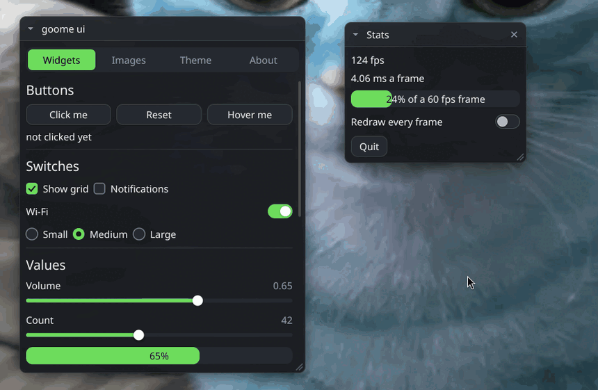
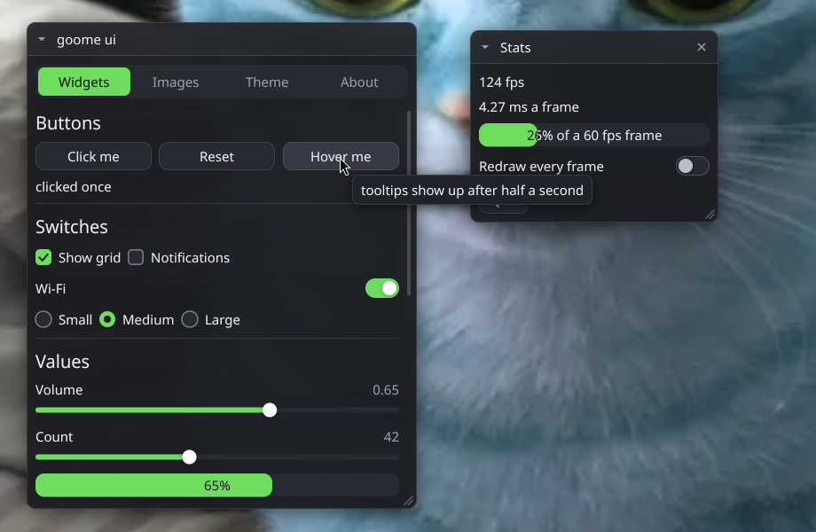

<p align="center">
  
</p>

<h1 align="center">🫠 goome 🫠</h1>

<p align="center">
<b>See-through, always on top overlays for any C program. One file, no dependencies, Linux, Windows and Mac.</b>
</p>

<p align="center">
  
  
  
  
  
  
</p>

<p align="center">
  goome puts a see-through layer over every monitor. You draw on it, and only the bits you draw take clicks, everything else goes straight through to whatever is under it.<br>
  It also does the other stuff you always end up needing for an overlay anyway, like hotkeys and grabbing whats on screen.<br> <br>
  Do you like this project? If so, please let me know!
  <a href="https://sevvy-wevvy.com/discord">Discord</a>
</p>

<p align="center">
  <br>
  <sub>the ui demo running on my gnome desktop. only the windows take clicks, the desktop behind them still works</sub>
</p>

<details>
<summary align="center"><b>⬇️ Get It ⬇️</b></summary>

<br>

<p align="center">
Open a terminal <b>in your project folder</b> and paste the line for your computer. It drops <code>goome.h</code> and a small example in there, gets you a C compiler if you dont have one yet, and builds the example so you know it works.
</p>

<h3 align="center">🐧 Linux &nbsp;·&nbsp; 🍎 Mac</h3>

```sh
curl -fsSL https://raw.githubusercontent.com/goome-ui/c-goome/main/get.sh | sh
```

<h3 align="center">🪟 Windows (PowerShell, not cmd)</h3>

```powershell
irm https://raw.githubusercontent.com/goome-ui/c-goome/main/get.ps1 | iex
```

<p align="center">
Already have a <code>goome.h</code> there? It gets saved as <code>goome.h.old</code> first, so running it again is also how you update.<br> <br>
You can also just download <a href="goome.h">goome.h</a> yourself, thats the whole library.
</p>
</details>

<details>
<summary align="center"><b>🚀 Quick Start 🚀</b></summary>

<br>

<p align="center">
Put this in <b>one</b> .c file in your project (thats where the actual code ends up):
</p>

```c
#define GOOME_IMPLEMENTATION
#include "goome.h"
```

<p align="center">
Then anywhere else just <code>#include "goome.h"</code>. A whole overlay that draws a box and prints clicks on it:
</p>

```c
#include <stdio.h>
#include "goome.h"

int main(void)
{
    goome *g = goome_open(&(goome_opts){.title = "my overlay"}, NULL);
    if (!g) return 1;

    goome_pacer pace = {0};
    for (;;) {
        goome_event ev;
        int wait = goome_pace(&pace, 60);
        while (goome_poll(g, &ev, wait) > 0) {
            if (ev.type == GOOME_QUIT) return 0;
            if (ev.type == GOOME_DOWN) printf("clicked at %.0f,%.0f\n", ev.x, ev.y);
            wait = goome_pace(&pace, 60);
        }

        goome_canvas *c = goome_begin(g, 0);  // monitor 0
        if (!c) continue;
        goome_draw_round_rect(c, 100, 100, 200, 80, 12, 0xE0202838);
        goome_draw_text(c, 116, 128, "click me", 1, 0xFFFFFFFF);
        goome_rect hit = {100, 100, 200, 80};  // only this part takes clicks
        goome_end(g, c, &hit, 1);
    }
}
```

<p align="center">
Build it like any other C file, no libraries to link:
</p>

```sh
cc -O2 -o myapp myapp.c goome.c
```
</details>

<details>
<summary align="center"><b>🧰 Visual Studio, Rider, VS Code 🧰</b></summary>

<br>

<p align="center">
<b>Using goome in your project:</b> its one header, so drag <code>goome.h</code> into your project, add a <code>goome.c</code> with the two lines from Quick Start, and youre done in any IDE. No include paths or linker settings to touch.<br> <br>
Just make sure <code>goome.c</code> is a <b>.c</b> file and not .cpp (including the header from C++ is fine).
</p>

<br>

<p align="center">
<b>Working on goome itself:</b> the repo is a normal CMake project with presets.
</p>

<p align="center">
<b>Visual Studio 2019/2022</b> - File > Open > Folder, pick the repo. It finds <code>CMakePresets.json</code> on its own, pick Debug or Release at the top and hit F5 on <code>hello.exe</code>.<br> <br>
<b>Rider</b> - File > Open, pick the repo folder (or <code>CMakeLists.txt</code>). Rider loads the CMake presets and the run configs show up by themselves.<br> <br>
<b>VS Code</b> - open the folder and install the extensions it asks for. Ctrl+Shift+B builds, <b>hello (test backend)</b> in the debug menu runs without touching your screen.
</p>

<p align="center">
If your project already uses CMake you can pull it in that way instead:
</p>

```cmake
add_subdirectory(c-goome)
target_link_libraries(myapp PRIVATE goome)
```
</details>

<details>
<summary align="center"><b>🖥️ Where It Works 🖥️</b></summary>

<br>

<p align="center">
goome picks the right way to do things on its own. <code>GOOME_BACKEND=x11</code> (or wayland, gnome, portal, test) forces one if you need to.
</p>

<div align="center">

| Where | Overlay | Screen grab | Global hotkeys |
|:--|:--|:--|:--|
| sway, Hyprland, river, wayfire, labwc, niri | layer-shell | wlr-screencopy | control fifo * |
| KDE Plasma 6, COSMIC | layer-shell | portal (asks once) | control fifo * |
| GNOME (Wayland) | XWayland window | Mutter ScreenCast, no popup | control fifo * |
| Cinnamon and other Wayland | XWayland window | portal (asks once) | control fifo * |
| Any X11 desktop (XFCE, KDE X11, MATE, i3, openbox...) | X11 window | X11 | yes |
| Windows 10 / 11 | layered windows | GDI | yes |
| macOS 14+ | NSPanel | ScreenCaptureKit | yes, with Accessibility on |

</div>

<p align="center">
* Wayland doesnt let apps grab keys system wide. Give goome a <code>state_dir</code> and it makes a little control fifo there, then bind a key in your compositor that runs <code>myapp --send hide</code> and call <code>goome_send(dir, "hide")</code> in it. You get it back as a <code>GOOME_CONTROL</code> event.<br> <br>
<code>goome_caps(g)</code> tells you what actually works where you are.
</p>
</details>

<details>
<summary align="center"><b>📸 Screenshot 📸</b></summary>

<br>

<p align="center">
  <br>
  <sub>the ui kit at full size, just floating over my wallpaper</sub>
</p>
</details>

<details>
<summary align="center"><b>📚 The API 📚</b></summary>

<br>

<p align="center">
Everything is in <a href="include/goome.h">include/goome.h</a>. Plain structs, no callbacks, every call returns <code>GOOME_OK</code> or a negative error and <code>goome_error(g)</code> says what went wrong.<br>
All positions are logical desktop coords, canvases and grabs carry the scale to real pixels.
</p>

| | |
|:--|:--|
| `goome_open` / `goome_close` | start and stop. `goome_backend_name` and `goome_caps` say what you got |
| `goome_monitors` | every monitor with its spot, size, scale and rotation |
| `goome_begin` / `goome_end` | get a monitor's canvas, draw, hand it back with the rects that should take clicks |
| `goome_poll` | clicks, mouse moves, scroll, keys, hotkeys, monitor changes, quit |
| `goome_pointer` | where the mouse is and whats held |
| `goome_keyboard` | take the keyboard while you need it (search boxes and stuff), then give it back |
| `goome_hotkey` | `goome_hotkey(g, "alt+h", 1)` grabs a key combo system wide |
| `goome_capture` | grab a monitor or a rect of it, always 0xFFRRGGBB |
| `goome_alpha_at` | is our overlay at this spot, for masking it out of grabs |
| `goome_pace` | frame timing helper for your loop |
| `goome_save_ppm` | dump pixels to a file, handy for debugging |
| `goome_draw_*` / `goome_clip_*` | shapes, gradients, shadows and clipping, see Drawing |
| `goome_bitmap_load` / `goome_draw_bitmap` | load PNG, JPEG, BMP, PPM, QOI and draw them |
| `goome_font_load` / `goome_font_system` / `goome_text` | real fonts and text |
| `goome_ui_*` | the ui kit, see UI Kit |
</details>

<details>
<summary align="center"><b>🎨 Drawing 🎨</b></summary>

<br>

<p align="center">
The drawing stuff is optional, you can also just write your own pixels into <code>c->px</code> (premultiplied ARGB) and call <code>goome_damage</code>.<br>
If you use it you get smooth shapes, images and real text. Only what changed gets sent to the screen, so a mostly empty overlay barely costs anything.
</p>

- rects, lines, triangles, circles, rings, arcs, polygons, outlines and gradients
- rounded rects with a different radius per corner, and soft shadows like css box-shadow
- clipping with `goome_clip_push` / `goome_clip_pop`, 16 deep
- `goome_bitmap_load` reads PNG, JPEG, BMP, PPM and QOI (it looks at whats in the file, not the name), `goome_draw_bitmap` draws them scaled, with rounded corners and a tint
- `goome_font_load` takes .ttf, .otf and .ttc, `goome_font_system(NULL)` finds the desktops normal ui font. Kerning and utf-8 work. Pass NULL as the font and you get the 6 built in bitmap fonts (same ones open-chease uses)

<p align="center">
<code>#define GOOME_NO_DRAW</code> before the implementation leaves all of it out (and the ui kit too).
</p>
</details>

<details>
<summary align="center"><b>🎛️ UI Kit 🎛️</b></summary>

<br>

<p align="center">
goome has its own immediate mode ui, kinda like Dear ImGui but made for overlays. You keep your own variables and call the widgets every frame. The gaps between windows stay click-through.
</p>

```c
goome_ui *u = goome_ui_new(g); // uses the system font when it finds one
goome_bitmap logo;
goome_bitmap_load("logo.png", &logo);
double x = 40, y = 40, w = 300, h = 0, volume = 0.5; // h 0 = fit the content

while (running) {
    goome_event ev;
    while (goome_poll(g, &ev, 16) > 0) {
        if (ev.type == GOOME_QUIT) running = 0;
        goome_ui_feed(u, &ev);
    }
    if (!goome_ui_begin(u, 0)) continue;
    if (goome_ui_window(u, "Settings", &x, &y, &w, &h, GOOME_WIN_MOVE | GOOME_WIN_COLLAPSE, NULL)) {
        goome_ui_image(u, &logo, 64, 64, 12);
        if (goome_ui_button(u, "Say hi")) puts("hi");
        goome_ui_slider(u, "Volume", &volume, 0, 1, "%.2f");
    }
    goome_ui_window_end(u);
    goome_ui_end(u);
}
goome_bitmap_free(&logo);
goome_ui_free(u);
```

<p align="center">
<b>Widgets</b> - buttons, image buttons, checkboxes, toggles, radios, sliders, text inputs, combo boxes, tabs, selectables, collapsing sections, progress bars, a color picker, tooltips, labels, headings and wrapped text<br>
<b>Windows</b> - drag, resize, collapse, close, they stack in the order you click them<br>
<b>Layout</b> - rows, same line, fixed widths, spacing and scroll areas that nest<br>
<b>Themes</b> - <code>goome_ui_theme(u)</code> hands you every color, radius, padding, font and font size. Dark and light built in<br>
<b>Smooth</b> - hovers, toggles and popups animate, <code>goome_ui_animating</code> tells you when to keep drawing so its idle the rest of the time<br> <br>
<code>examples/ui.c</code> shows off all of it, run <code>build/ui</code>. <code>#define GOOME_NO_UI</code> leaves the ui kit out.
</p>
</details>

<details>
<summary align="center"><b>🧪 Testing Without A Screen 🧪</b></summary>

<br>

<p align="center">
The <b>test</b> backend fakes a whole screen so you can test your overlay app in CI. You give it a script of what the "user" does and it saves a screenshot after every frame you draw. No code changes needed, its all env vars:
</p>

```sh
GOOME_TEST_FRAMES=frames/ GOOME_TEST_SHOTS=shots/ GOOME_TEST_SCRIPT=script.txt ./myapp
```

```
screen 1920x1080 2     # size and scale when there are no frames
3 click 400,300        # frame 3, a click
4 key hello\n          # typed, \b \e \n \t for backspace esc enter tab
5 hover 120,80         # the mouse sits there from now on
6 hold 200,200 9       # button down on frame 6, up on frame 9
7 scroll 400,300 -1    # one notch up
8 hotkey alt+h         # a grabbed combo comes back as GOOME_HOTKEY
9 send hide            # a control fifo line
end 12                 # GOOME_QUIT after frame 12
```

<p align="center">
Clicks outside your hit rects get dropped just like on a real screen, and the shots come out byte for byte the same on Linux, Windows and Mac. Thats how goome's own tests run in CI.
</p>
</details>

<details>
<summary align="center"><b>⚠️ Good To Know ⚠️</b></summary>

<br>

<p align="center">
• Call <code>goome_poll</code> at least every ~30 ms while you have clickable stuff up. On Windows and Mac the click-through gets switched on and off as the mouse moves, and that happens inside poll<br>
• On Mac, call goome from the main thread (AppKit wants that), and screen grabs need Screen Recording permission for whatever app you run it from (your terminal, usually)<br>
• KDE, COSMIC and Cinnamon show a "share your screen" popup the first time you grab. Set <code>state_dir</code> and it remembers your answer<br>
• Overlay only and dont need grabs? Set <code>no_capture</code> and goome never asks for screen access at all<br>
• Your overlay shows up in your own grabs on Linux. Check <code>img.has_self</code> and mask it with <code>goome_alpha_at</code>. On Windows and Mac, <code>hide_self</code> can keep it out<br>
• Linux builds work back to glibc 2.34. All the desktop libraries get loaded at runtime, if one is missing goome just picks something else
</p>
</details>

<details>
<summary align="center"><b>🔧 Building goome Itself 🔧</b></summary>

<br>

```sh
./build.sh test     # library, examples and tests into build/, then runs the tests
./build.sh win      # windows exes with mingw
./build.sh single   # remakes goome.h from src/
```

<p align="center">
Dont edit <code>goome.h</code> by hand, it gets made from <code>include/</code> and <code>src/</code>. The weird desktop bugs are all in <a href="docs/DESIGN.md">docs/DESIGN.md</a>.
</p>
</details>

<details>
<summary align="center"><b>🛠 Pull Requests 🛠</b></summary>

<br>

<p align="center">
Want to help with goome? Make A pull request to <b>dev</b>!<br>
Small fixes are the easiest to merge, for anything bigger open an issue first so we can talk about it. A desktop it doesnt work on yet is the most useful thing you can send.<br> <br>
As long as it works and doesnt add a dependency its very likely to get accepted!<br>
Read <a href="CONTRIBUTING.md">CONTRIBUTING.md</a> before you send one.
</p>
</details>

<details>
<summary align="center"><b>⚖️ License ⚖️</b></summary>

<br>

<p align="center">
goome is under the <a href="LICENSE">GPL-3.0</a>.<br> <br>
<sub>
• You can use it, change it and share it<br>
• If you share something made with it, you have to share your source too, under the same license<br>
• Keep the credits
</sub><br> <br>
In short: play fair, keep it open, and give credit where it's due.
</p>
</details>

<details>
<summary align="center"><b>🩷 Donate 🩷</b></summary>

<br>

<p align="center">
<a href="https://sevvy-wevvy.com/kofi">Ko-fi</a> (Preferred)<br>
<a href="https://sevvy-wevvy.com/patreon">Patreon</a><br>
<a href="https://sevvy-wevvy.com/throne">Throne</a>
</p>
</details>
