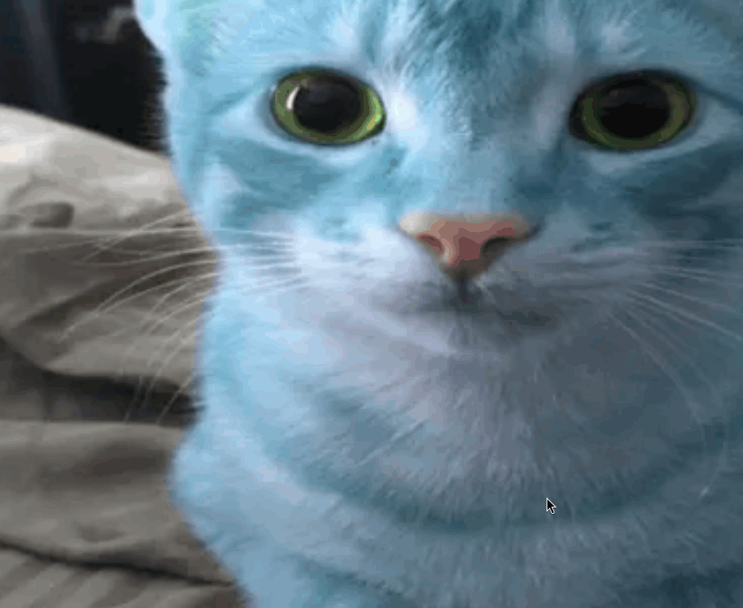
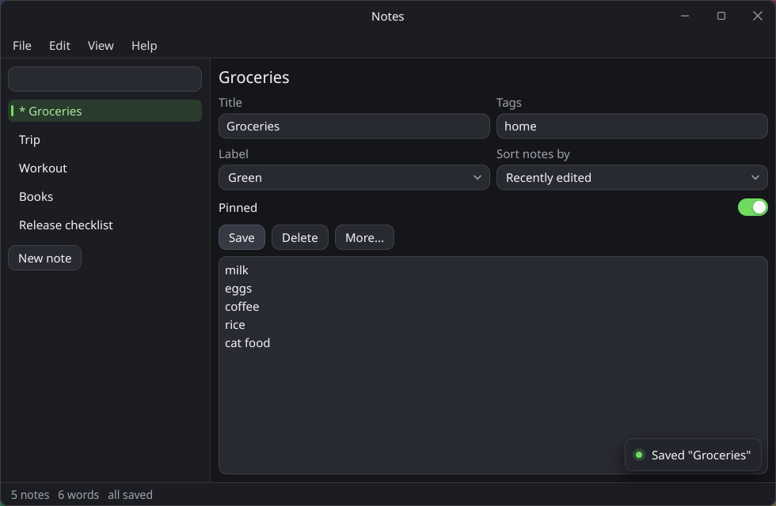
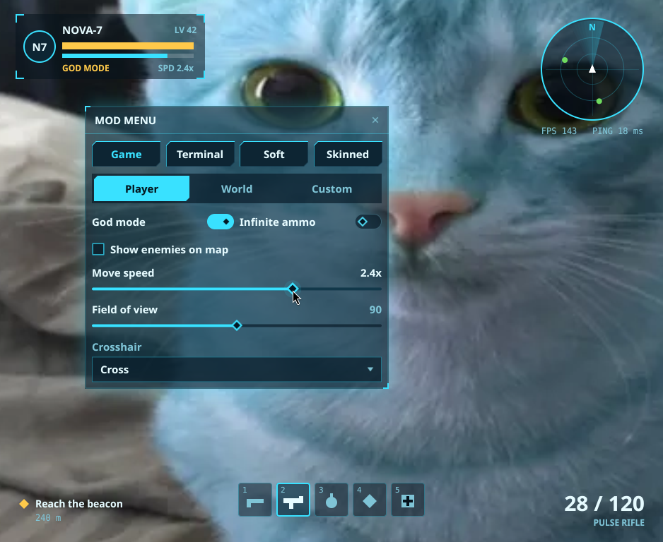
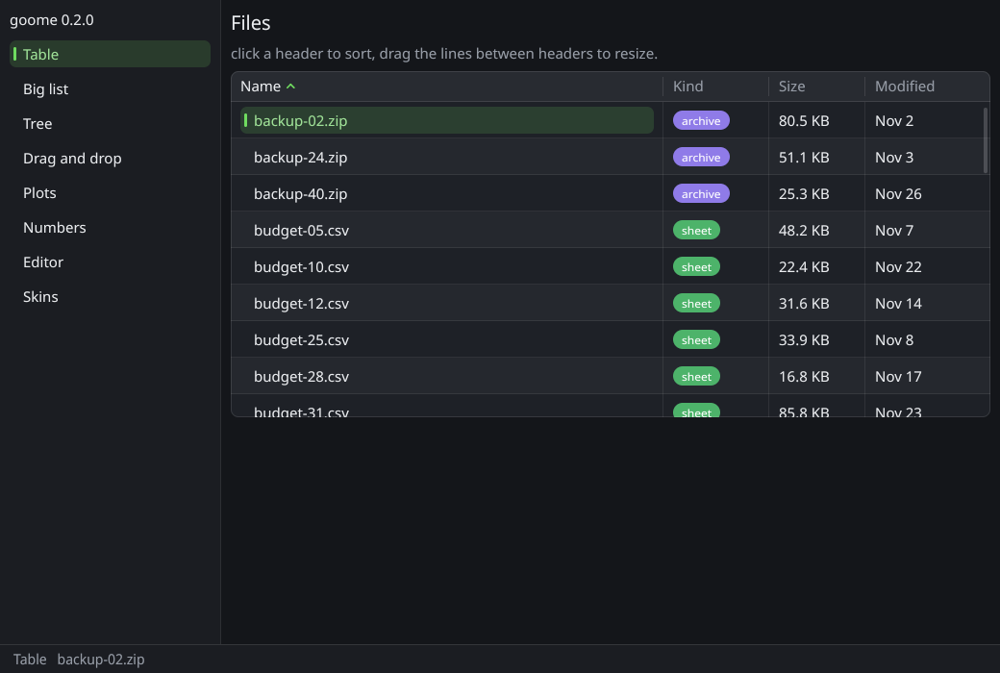
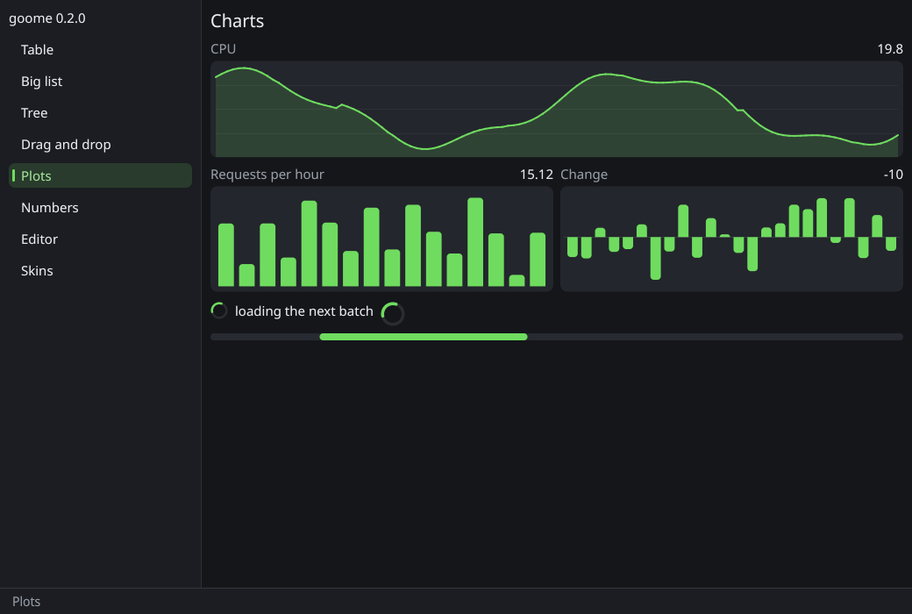

<p align="center">
  
</p>

<h1 align="center">🫠 goome 🫠</h1>

<p align="center">
<b>See-through overlays, normal app windows and game engine ui for any C program. One file, no dependencies, Linux, Windows and Mac.</b>
</p>

<p align="center">
  
  
  
  
  
  
</p>

<p align="center">
  goome started as a see-through layer over every monitor. You draw on it, and only the bits you draw take clicks, everything else goes straight through to whatever is under it.<br>
  Since 0.2 the same code also makes normal windows with a title bar, or draws into a plain pixel buffer for Unity and other engines.<br>
  It also does hotkeys, the clipboard and screen grabs.<br> <br>
  Do you like this project? If so, please let me know!
  <a href="https://sevvy-wevvy.com/discord">Discord</a>
</p>

<p align="center">
  <a href="https://goome-ui.github.io/docs/">Docs</a> &nbsp;·&nbsp;
  <a href="https://github.com/goome-ui/examples">Examples</a> &nbsp;·&nbsp;
  <a href="https://github.com/goome-ui/csharp-goome">C# + Unity</a> &nbsp;·&nbsp;
  <a href="https://github.com/goome-ui/python-goome">Python</a>
</p>

<p align="center">
  <br>
  <sub>the ui demo running on my gnome desktop. only the windows take clicks, the desktop behind them still works</sub>
</p>

<details>
<summary align="center"><b>⬇️ Get It ⬇️</b></summary>

<br>

<p align="center">
Open a terminal <b>in your project folder</b> and paste the line for your computer. It drops <code>goome.h</code> and a small example in there, gets you a C compiler if you dont have one yet, and builds the example so you know it works.
</p>

<h3 align="center">🐧 Linux &nbsp;·&nbsp; 🍎 Mac</h3>

```sh
curl -fsSL https://raw.githubusercontent.com/goome-ui/c-goome/main/get.sh | sh
```

<h3 align="center">🪟 Windows (PowerShell, not cmd)</h3>

```powershell
irm https://raw.githubusercontent.com/goome-ui/c-goome/main/get.ps1 | iex
```

<p align="center">
Already have a <code>goome.h</code> there? It gets saved as <code>goome.h.old</code> first, so running it again is also how you update.<br> <br>
You can also just download <a href="goome.h">goome.h</a> yourself, thats the whole library.
</p>

<br>

<p align="center">
Put this in <b>one</b> .c file in your project (thats where the actual code ends up), then anywhere else just <code>#include "goome.h"</code>:
</p>

```c
#define GOOME_IMPLEMENTATION
#include "goome.h"
```

<p align="center">
Build it like any other C file, no libraries to link:
</p>

```sh
cc -O2 -o myapp myapp.c goome.c
```
</details>

<details>
<summary align="center"><b>🫥 Overlay On Top Of Everything 🫥</b></summary>

<br>

<p align="center">
This is the default, and what goome was made for. A see-through layer over every monitor, clicks only land on what you say. A whole overlay that draws a box and prints clicks on it:
</p>

```c
#include <stdio.h>
#include "goome.h"

int main(void)
{
    goome *g = goome_open(&(goome_opts){.title = "my overlay"}, NULL);
    if (!g) return 1;

    goome_pacer pace = {0};
    for (;;) {
        goome_event ev;
        int wait = goome_pace(&pace, 60);
        while (goome_poll(g, &ev, wait) > 0) {
            if (ev.type == GOOME_QUIT) return 0;
            if (ev.type == GOOME_DOWN) printf("clicked at %.0f,%.0f\n", ev.x, ev.y);
            wait = goome_pace(&pace, 60);
        }

        goome_canvas *c = goome_begin(g, 0);  // monitor 0
        if (!c) continue;
        goome_draw_round_rect(c, 100, 100, 200, 80, 12, 0xE0202838);
        goome_draw_text(c, 116, 128, "click me", 1, 0xFFFFFFFF);
        goome_rect hit = {100, 100, 200, 80};  // only this part takes clicks
        goome_end(g, c, &hit, 1);
    }
}
```
</details>

<details>
<summary align="center"><b>🪟 Make A Normal App 🪟</b></summary>

<br>

<p align="center">
<code>goome_open_app</code> gives you a real window with a title bar, and the ui kit fills it:
</p>

```c
#include "goome.h"

int main(void)
{
    goome *g = goome_open_app("my app", 640, 400, NULL);
    if (!g) return 1;
    goome_ui *u = goome_ui_new(g);
    int running = 1, clicks = 0;

    while (running) {
        goome_event ev;
        while (goome_poll(g, &ev, 16) > 0) {
            if (ev.type == GOOME_CLOSE || ev.type == GOOME_QUIT) running = 0;
            goome_ui_feed(u, &ev);
        }
        if (!goome_ui_begin(u, 0)) continue;
        goome_ui_app(u, "my app", 0); // fills the whole window
        if (goome_ui_button(u, "Click me")) clicks++;
        goome_ui_label(u, "clicked %d times", clicks);
        goome_ui_app_end(u);
        goome_ui_end(u);
    }
    goome_ui_free(u);
    goome_close(g);
    return 0;
}
```

<p align="center">
Flags, events and the rest are in Window Mode further down.
</p>
</details>

<details>
<summary align="center"><b>🎮 Inside Unity Or A Game Engine 🎮</b></summary>

<br>

<p align="center">
goome draws into a pixel buffer, you upload it as a texture and hand goome the engines mouse and keys:
</p>

```c
#include "goome.h"

int main(void)
{
    goome *g = goome_open(&(goome_opts){.mode = GOOME_MODE_OFFSCREEN, .width = 400, .height = 300}, NULL);
    if (!g) return 1;
    goome_ui *u = goome_ui_new(g);
    double x = 20, y = 20, w = 260, h = 0, volume = 0.5;

    for (int frame = 0; frame < 3; frame++) { // your engines update loop
        goome_event click = {.type = GOOME_DOWN, .x = 60, .y = 80, .button = 1};
        goome_push(g, &click); // the engine hands goome its mouse and keys

        goome_event ev;
        while (goome_poll(g, &ev, 0) > 0) goome_ui_feed(u, &ev);
        if (!goome_ui_begin(u, 0)) continue;
        if (goome_ui_window(u, "Pause menu", &x, &y, &w, &h, GOOME_WIN_MOVE, NULL))
            goome_ui_slider(u, "Volume", &volume, 0, 1, "%.2f");
        goome_ui_window_end(u);
        goome_ui_end(u);

        goome_image img;
        if (goome_frame(g, &img) == GOOME_OK) {
            // img.px is img.w x img.h premultiplied argb, upload it as a texture
        }
    }
    goome_ui_free(u);
    goome_close(g);
    return 0;
}
```

<p align="center">
On Unity just use the package in the <a href="https://github.com/goome-ui/csharp-goome">C# binding</a>. The rest is under Offscreen.
</p>
</details>

<details>
<summary align="center"><b>🧰 Visual Studio, Rider, VS Code 🧰</b></summary>

<br>

<p align="center">
<b>Using goome in your project:</b> its one header, so drag <code>goome.h</code> into your project, add a <code>goome.c</code> with the two lines from Get It, and youre done in any IDE. No include paths or linker settings to touch.<br> <br>
Just make sure <code>goome.c</code> is a <b>.c</b> file and not .cpp (including the header from C++ is fine).
</p>

<br>

<p align="center">
<b>Working on goome itself:</b> the repo is a normal CMake project with presets.
</p>

<p align="center">
<b>Visual Studio 2019/2022</b> - File > Open > Folder, pick the repo. It finds <code>CMakePresets.json</code> on its own, pick Debug or Release at the top and hit F5 on <code>hello.exe</code>.<br> <br>
<b>Rider</b> - File > Open, pick the repo folder (or <code>CMakeLists.txt</code>). Rider loads the CMake presets and the run configs show up by themselves.<br> <br>
<b>VS Code</b> - open the folder and install the extensions it asks for. Ctrl+Shift+B builds, <b>hello (test backend)</b> in the debug menu runs without touching your screen.
</p>

<p align="center">
If your project already uses CMake you can pull it in that way instead:
</p>

```cmake
add_subdirectory(c-goome)
target_link_libraries(myapp PRIVATE goome)
```
</details>

<details>
<summary align="center"><b>🖥️ Where It Works 🖥️</b></summary>

<br>

<p align="center">
goome picks the right way to do things on its own. <code>GOOME_BACKEND=x11</code> (or wayland, gnome, portal, test, offscreen) forces one if you need to.
</p>

<div align="center">

| Where | Overlay | App window | Screen grab | Global hotkeys |
|:--|:--|:--|:--|:--|
| sway, Hyprland, river, wayfire, labwc, niri | layer-shell | xdg-shell | wlr-screencopy | control fifo * |
| KDE Plasma 6, COSMIC | layer-shell | xdg-shell | portal (asks once) | control fifo * |
| GNOME (Wayland) | XWayland window | XWayland window, real title bar | Mutter ScreenCast, no popup | control fifo * |
| Cinnamon, weston and other Wayland | XWayland window | xdg-shell | portal (asks once) | control fifo * |
| Any X11 desktop (XFCE, KDE X11, MATE, i3, openbox...) | X11 window | X11 window | X11 | yes |
| Windows 10 / 11 | layered windows | normal window, per monitor DPI | GDI | yes |
| macOS 14+ | NSPanel | NSWindow | ScreenCaptureKit | yes, with Accessibility on |

</div>

<p align="center">
* Wayland doesnt let apps grab keys system wide. Give goome a <code>state_dir</code> and it makes a little control fifo there, then bind a key in your compositor that runs <code>myapp --send hide</code> and call <code>goome_send(dir, "hide")</code> in it. You get it back as a <code>GOOME_CONTROL</code> event.<br> <br>
On Wayland the title bar comes from the compositor when it offers one. Where it doesnt (weston, some smaller ones) goome draws its own with min, max and close.<br> <br>
Offscreen mode works everywhere, it never touches the desktop.<br> <br>
<code>goome_caps(g)</code> tells you what actually works where you are.
</p>
</details>

<details>
<summary align="center"><b>🪟 Window Mode 🪟</b></summary>

<br>

<p align="center">
  <br>
  <sub>examples/app_ui.c, a small notes app. the title bar, menus and toast are all goome</sub>
</p>

<p align="center">
For more control than <code>goome_open_app</code> set <code>.mode = GOOME_MODE_WINDOW</code> in <code>goome_opts</code> with <code>width</code>, <code>height</code>, <code>min_width</code>, <code>min_height</code> and <code>window_flags</code>:
</p>

<div align="center">

| `GOOME_WINDOW_` | |
|:--|:--|
| `RESIZABLE` | the user can resize it |
| `BORDERLESS` | no title bar from the os, draw your own with `GOOME_APP_TITLEBAR` |
| `TRANSPARENT` | canvas alpha is real window alpha, for round corners and odd shapes |
| `ON_TOP` | stays above other windows |
| `HIDDEN` | starts hidden, `goome_window_show` shows it |
| `CENTER` | opens in the middle of the screen |

</div>

<p align="center">
The window is monitor 0, so all your overlay code keeps working. <code>goome_begin(g, 0)</code> gives you the client area, positions are relative to its top left, and a resize or a DPI change sends <code>GOOME_MONITORS</code>. The whole window takes clicks and the keyboard is on while its focused.<br> <br>
New events: <code>GOOME_CLOSE</code> (close button, alt+f4, cmd+w). goome won't close the window itself, so you can still ask "save first?". Then <code>GOOME_FOCUS</code> and <code>GOOME_DROP</code> for files dropped on it (<code>goome_drop_path</code> has the full path).<br> <br>
<code>goome_window_title</code>, <code>_size</code>, <code>_pos</code>, <code>_state</code> (minimize, maximize, fullscreen), <code>_show</code> and <code>_drag</code> (start a native move or resize from a click, for your own title bar). Plus <code>goome_cursor</code> and <code>goome_clipboard_set</code> / <code>_get</code>.<br> <br>
Want two windows? Open two goome handles, each one is its own window. Hotkeys and grabs work like in overlay mode.
</p>
</details>

<details>
<summary align="center"><b>🎮 Offscreen 🎮</b></summary>

<br>

<p align="center">
No os window here at all. It never blocks or starts a thread and doesn't load anything. Set <code>.mode = GOOME_MODE_OFFSCREEN</code> with <code>width</code>, <code>height</code> and <code>scale</code>. Events you push are plain <code>goome_event</code>s, and the frame from <code>goome_frame</code> is good until the next <code>goome_begin</code>.<br> <br>
<code>goome_hit</code> tells you if a point is on the ui, if its not just pass the click on to your game. <code>goome_resize</code> changes the size or scale. The ui still asks for cursors and the clipboard, read <code>goome_cursor_shape</code> and <code>goome_clipboard_get</code> and set the real ones yourself.<br> <br>
<code>examples/offscreen.c</code> pushes a few clicks and some typing and saves the frame as a picture.
</p>
</details>

<h3 align="center">📸 Screenshots 📸</h3>

<p align="center">
  <br>
  <sub>the ui kit at full size, just floating over my wallpaper</sub>
</p>

<p align="center">
  <br>
  <sub>examples/widgets.c, a sortable table you can resize the columns of</sub>
</p>

<p align="center">
  <br>
  <sub>same example, the plots page</sub>
</p>

<details>
<summary align="center"><b>📚 The API 📚</b></summary>

<br>

<p align="center">
Everything is in <a href="include/goome.h">include/goome.h</a>. Plain structs, no callbacks, errors come back as negative <code>GOOME_E*</code> codes and <code>goome_error(g)</code> says what went wrong. Most calls return <code>GOOME_OK</code>, the ones that count stuff (<code>goome_poll</code>, <code>goome_monitors</code>, <code>goome_hit</code>) return the count or 0/1.<br>
All positions are logical coords, canvases and grabs carry the scale to real pixels. The <a href="https://goome-ui.github.io/docs/">docs site</a> goes through every function.
</p>

| | |
|:--|:--|
| `goome_open` / `goome_close` | start and stop. `goome_backend_name`, `goome_mode` and `goome_caps` say what you got |
| `goome_open_app` | a normal resizable window, centered |
| `goome_monitors` | every monitor with its spot, size, scale and rotation (the window in window mode) |
| `goome_begin` / `goome_end` | get a monitors canvas, draw, hand it back with the rects that should take clicks |
| `goome_poll` | clicks, mouse moves, scroll, keys, hotkeys, monitor changes, close, focus, drops, quit |
| `goome_pointer` | where the mouse is and whats held |
| `goome_keyboard` | take the keyboard while you need it (search boxes and stuff), then give it back |
| `goome_hotkey` | `goome_hotkey(g, "alt+h", 1)` grabs a key combo system wide |
| `goome_capture` | grab a monitor or a rect of it, always 0xFFRRGGBB |
| `goome_alpha_at` | is our overlay at this spot, for masking it out of grabs |
| `goome_window_*` | title, size, position, minimize/maximize/fullscreen, show, native drag |
| `goome_cursor` / `goome_clipboard_*` | the mouse cursor shape and the clipboard |
| `goome_push` / `goome_frame` / `goome_hit` / `goome_resize` | feed events in, read the frame out, offscreen and automation |
| `goome_pace` | frame timing helper for your loop |
| `goome_save_ppm` | dump pixels to a file, handy for debugging |
| `goome_draw_*` / `goome_clip_*` | shapes, gradients, shadows, nine slice and clipping, see Drawing |
| `goome_bitmap_load` / `goome_draw_bitmap` | load PNG, JPEG, BMP, PPM, QOI and draw them |
| `goome_font_load` / `goome_font_system` / `goome_text` | real fonts and text |
| `goome_ui_*` | the ui kit, see UI Kit |
</details>

<details>
<summary align="center"><b>🎨 Drawing 🎨</b></summary>

<br>

<p align="center">
The drawing stuff is optional, you can also just write your own pixels into <code>c->px</code> (premultiplied ARGB) and call <code>goome_damage</code>.<br>
If you use it you get smooth shapes, images and real text. Only what changed gets sent to the screen.
</p>

- rects, lines, triangles, circles, rings, arcs, polygons, outlines and gradients
- rounded rects with a different radius per corner, and soft shadows like css box-shadow
- clipping with `goome_clip_push` / `goome_clip_pop`, 16 deep
- `goome_bitmap_load` reads PNG, JPEG, BMP, PPM and QOI (it looks at whats in the file, not the name), `goome_draw_bitmap` draws them scaled, with rounded corners and a tint
- `goome_draw_bitmap_nine` stretches a bitmap with fixed corners, for skins
- `goome_font_load` takes .ttf, .otf and .ttc, `goome_font_system(NULL)` finds the desktops normal ui font. Kerning and utf-8 work. Pass NULL as the font and you get the 6 built in bitmap fonts (same ones open-chease uses)

<p align="center">
<code>#define GOOME_NO_DRAW</code> before the implementation leaves all of it out (and the ui kit too).
</p>
</details>

<details>
<summary align="center"><b>🎛️ UI Kit 🎛️</b></summary>

<br>

<p align="center">
goome has its own immediate mode ui, kinda like Dear ImGui. You keep your own variables and call the widgets every frame. In overlay mode the gaps between windows stay click-through.
</p>

```c
goome_ui *u = goome_ui_new(g); // uses the system font when it finds one
goome_bitmap logo;
goome_bitmap_load("logo.png", &logo);
double x = 40, y = 40, w = 300, h = 0, volume = 0.5; // h 0 = fit the content

while (running) {
    goome_event ev;
    while (goome_poll(g, &ev, 16) > 0) {
        if (ev.type == GOOME_QUIT) running = 0;
        goome_ui_feed(u, &ev);
    }
    if (!goome_ui_begin(u, 0)) continue;
    if (goome_ui_window(u, "Settings", &x, &y, &w, &h, GOOME_WIN_MOVE | GOOME_WIN_COLLAPSE, NULL)) {
        goome_ui_image(u, &logo, 64, 64, 12);
        if (goome_ui_button(u, "Say hi")) puts("hi");
        goome_ui_slider(u, "Volume", &volume, 0, 1, "%.2f");
    }
    goome_ui_window_end(u);
    goome_ui_end(u);
}
goome_bitmap_free(&logo);
goome_ui_free(u);
```

<p align="center">
<b>Widgets</b> - buttons, image buttons, checkboxes, toggles, radios, sliders, text inputs, combo boxes, tabs, selectables, collapsing sections, progress bars, a color picker, tooltips, labels, headings and wrapped text<br>
<b>Windows</b> - drag, resize, collapse, close, they stack in the order you click them<br>
<b>Layout</b> - rows, same line, fixed widths, spacing and scroll areas that nest<br>
<b>Themes</b> - <code>goome_ui_theme(u)</code> hands you every color, radius, padding, font and font size. Dark and light built in, and nine slice skins for buttons, panels and inputs<br>
<b>Smooth</b> - hovers, toggles and popups animate, <code>goome_ui_animating</code> tells you when to keep drawing so its idle the rest of the time
</p>

<h3 align="center">For apps</h3>

<p align="center">
<code>goome_ui_app</code> is a root panel that fills the window. It can draw its own title bar (drag it, double click to maximize, edge resize on borderless windows) plus a menu bar and a status bar.<br> <br>
Menus nest and show shortcuts and check marks, and right click menus work on any widget. Popups and modals (the dim everything kind) close with esc. Toasts pop up bottom right.<br> <br>
Tab and shift+tab move focus, and text boxes do selection, undo and ctrl+c/x/v with the real clipboard.
</p>

<h3 align="center">More widgets</h3>

<p align="center">
A multi line text editor (line numbers, wrap, undo/redo), tables you can sort and resize with any widget in a cell, trees, drag-to-change numbers, line and bar plots, split panes, drag and drop between widgets, spinners, links and badges.<br>
For huge lists theres <code>goome_ui_list_clip</code>, it only draws the rows you can see.<br> <br>
<code>examples/ui.c</code> shows off the overlay side, <code>examples/app_ui.c</code> is the notes app and <code>examples/widgets.c</code> has a page for each new widget. The <a href="https://github.com/goome-ui/examples">examples repo</a> has a lot more, small real apps you can copy from. <code>#define GOOME_NO_UI</code> leaves the ui kit out.
</p>
</details>

<details>
<summary align="center"><b>🧪 Testing Without A Screen 🧪</b></summary>

<br>

<p align="center">
The <b>test</b> backend fakes a whole screen so you can test your app in CI. You give it a script of what the "user" does and it saves a screenshot after every frame you draw. No code changes needed, its all env vars. It does window mode too, so the same thing works for apps:
</p>

```sh
GOOME_TEST_SHOTS=shots/ GOOME_TEST_SCRIPT=script.txt ./myapp
```

<p align="center">
The script format (clicks, keys, hotkeys, resizes, drops...) is in <a href="docs/DESIGN.md">docs/DESIGN.md</a> under Test.
</p>

<p align="center">
Clicks outside your hit rects get dropped just like on a real screen, and the shots come out byte for byte the same on Linux, Windows and Mac. Thats how goomes own tests run in CI, and it's how the screenshots up there got made.
</p>
</details>

<details>
<summary align="center"><b>⚠️ Good To Know ⚠️</b></summary>

<br>

<p align="center">
• Call <code>goome_poll</code> at least every ~30 ms while you have clickable stuff up. On Windows and Mac the click-through gets switched on and off as the mouse moves, and that happens inside poll, so a slow loop means clicks land on the wrong thing<br>
• On Mac, call goome from the main thread (AppKit wants that), and screen grabs need Screen Recording permission for whatever app you run it from (your terminal, usually)<br>
• KDE, COSMIC and Cinnamon show a "share your screen" popup the first time you grab. Set <code>state_dir</code> and it remembers your answer<br>
• Dont need grabs? Set <code>no_capture</code><br>
• Your overlay shows up in your own grabs on Linux. Check <code>img.has_self</code> and mask it with <code>goome_alpha_at</code>. On Windows and Mac, <code>hide_self</code> can keep it out<br>
• Wayland wont tell an app where its window is, so <code>goome_window_pos</code> says <code>GOOME_ENOTSUP</code> there and grabs are off in window mode<br>
• <code>goome_clipboard_get</code> can take ~250 ms on Linux<br>
• Linux builds work back to glibc 2.34. All the desktop libraries get loaded at runtime, if one is missing goome just picks something else
</p>
</details>

<details>
<summary align="center"><b>🔧 Building goome Itself 🔧</b></summary>

<br>

```sh
./build.sh test     # library, examples and tests into build/, then runs the tests
./build.sh win      # windows exes with mingw
./build.sh single   # remakes goome.h from src/
```

<p align="center">
Dont edit <code>goome.h</code> by hand, it gets made from <code>include/</code> and <code>src/</code>. The weird desktop bugs are all in <a href="docs/DESIGN.md">docs/DESIGN.md</a>.
</p>
</details>

<details>
<summary align="center"><b>🛠 Pull Requests 🛠</b></summary>

<br>

<p align="center">
Want to help with goome? Make A pull request to <b>dev</b>!<br>
Small fixes are the easiest to merge, for anything bigger open an issue first so we can talk about it. A desktop it doesnt work on yet is the most useful thing you can send.<br> <br>
As long as it works and doesnt add a dependency its very likely to get accepted!<br>
Read <a href="CONTRIBUTING.md">CONTRIBUTING.md</a> before you send one.
</p>
</details>

<details>
<summary align="center"><b>⚖️ License ⚖️</b></summary>

<br>

<p align="center">
goome is under the <a href="LICENSE">GPL-3.0</a>.<br> <br>
<sub>
• You can use it, change it and share it<br>
• If you share something made with it, you have to share your source too, under the same license<br>
• Keep the credits
</sub><br> <br>
In short: play fair, keep it open, and give credit where it's due.
</p>
</details>

<details>
<summary align="center"><b>🩷 Donate 🩷</b></summary>

<br>

<p align="center">
<a href="https://sevvy-wevvy.com/kofi">Ko-fi</a> (Preferred)<br>
<a href="https://sevvy-wevvy.com/patreon">Patreon</a><br>
<a href="https://sevvy-wevvy.com/throne">Throne</a>
</p>
</details>
